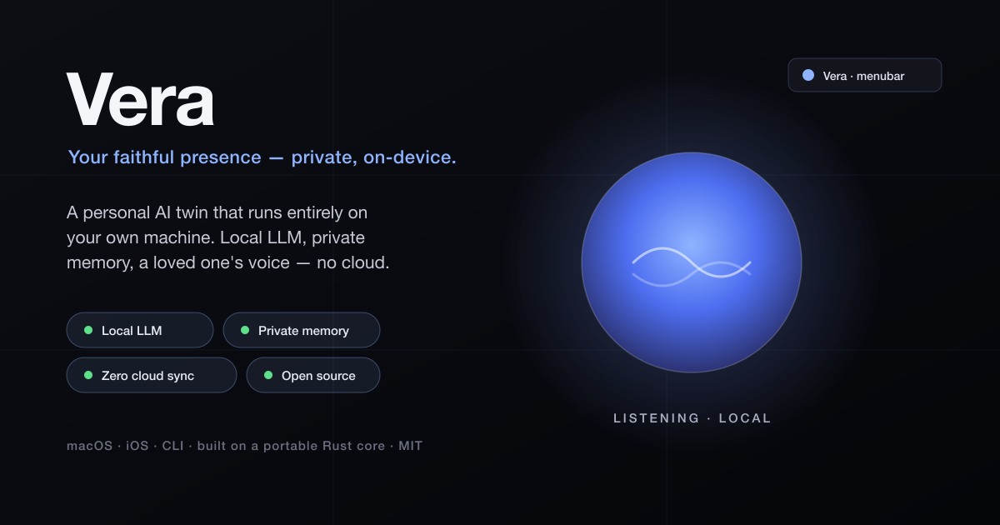

  

<h1 align="center">Vera</h1>

<em>A private, on-device twin of someone you love — in their voice, on your machine, never the cloud.</em>

  
  
  
  
  

---

**Vera** (Latin *verus* — **true**) is a private, on-device twin of someone you love.
You shape a persona of *your* person — their character, their voice, their stories —
and it carries their warmth forward. A floating orb on your screen: tap it, and chat —
type or talk, and it answers warmly, in their voice.

**Everything stays on your machine.** A twin of a loved one is the one thing you can
*never* hand to a cloud. So Vera doesn't: it thinks on a **local LLM**, keeps its memory
**sealed on your device**, and generates the **voice locally**. Nothing leaves unless *you*
allow it.

## Install

| Platform | How |
| --- | --- |
| **macOS** | Download `Vera.dmg` from [**Releases**](https://github.com/sinhaankur/cognitive-twin-agent/releases/latest), drag into Applications, right-click → Open. |
| **Run from source** | `./run.sh` — sets up, starts her brain, opens the UI. |
| **Linux / Windows / server** | `pipx install cognitive-twin-agent` then `vera-app` — or `docker compose up -d`. |

She thinks on a local model via [Ollama](https://ollama.com): `ollama pull qwen2.5:3b` (or her own `vera-tuned`).

## Use her

- **Make her yours** — `python -m cognitive_twin setup` (name, persona, voice — all on-device).
- **Talk** — tap the orb, type or speak. She remembers your days, feels the moment, and has a
  voice for every emotion.
- **Your people can meet her** — recognised guests get a warm chat; your private world stays yours.
- **Drop a PDF** into the chat and she'll read and discuss it.
- **Is she working?** — `./scripts/up.sh` syncs, (re)builds, and prints a plain-English
  readiness report; `ctwin doctor` shows it anytime (what's on, what's off, the one next thing).

## Private by design

- Thinks on a **local LLM**, sealed memory (ChaCha20), secrets in the Keychain — **zero cloud by default**.
- A **kill switch**, reach control (this Mac / your devices), and a built-in security audit.
- Opt-in senses (camera, mic, Photos, Calendar, Mail, Location) — off until you turn them on, nothing uploaded.

## Tech stack

Every piece runs on your machine — no cloud service in the critical path.

| Layer | Built with |
| --- | --- |
| **Thinking** | Local LLM via [**Ollama**](https://ollama.com) (`vera-tuned` / `qwen2.5:3b`), a hybrid semantic + keyword **RAG** (numpy, `nomic-embed-text`) with a learned reranker, and a numpy **affect net** (backprop-trained) for how she feels. |
| **Voice (out)** | On-device **Kokoro** TTS (`af_heart`) + a `voicebox` emotion→tone engine — a distinct delivery for grief, stress, tenderness, joy. No samples, no streaming. |
| **Voice (in)** | Local **Whisper** STT + **voice identity**: a sealed voiceprint that learns *your* voice over time (pure-numpy MFCC by default; optional **ECAPA-TDNN via ONNX Runtime** for best, noise-robust accuracy) so she answers you, not the TV. |
| **Memory** | Sealed vault — **ChaCha20-Poly1305**, key device-bound in the **macOS Keychain**; durable auto-backup to iCloud Drive. Nothing leaves unless you allow it. |
| **Apps** | Native **macOS** app (SwiftUI + AVFoundation + Vision gaze), **iOS** app (Rust core → Ollama), a **web UI**, and an **MCP** server — all talking to one Python brain. |
| **Runtime** | **Python** brain as a `launchd`/`systemd` service; distributed as a signed `.dmg`, `pipx` install, or `docker compose`. Runs on bare Python — heavy deps (ONNX, embeddings) are all optional, with graceful fallbacks. |

## More

- **[Roadmap](ROADMAP.md)** — what's built, what's missing, what's next.
- **[Full docs](docs/README-full.md)** — the complete guide (model routing, memory, automations, skills, and more).
- **[Privacy](PRIVACY.md)** · **[Security](SECURITY.md)**

---

<em>The privacy isn't a feature here — it's the only thing that makes a twin of someone you love possible at all.</em>

